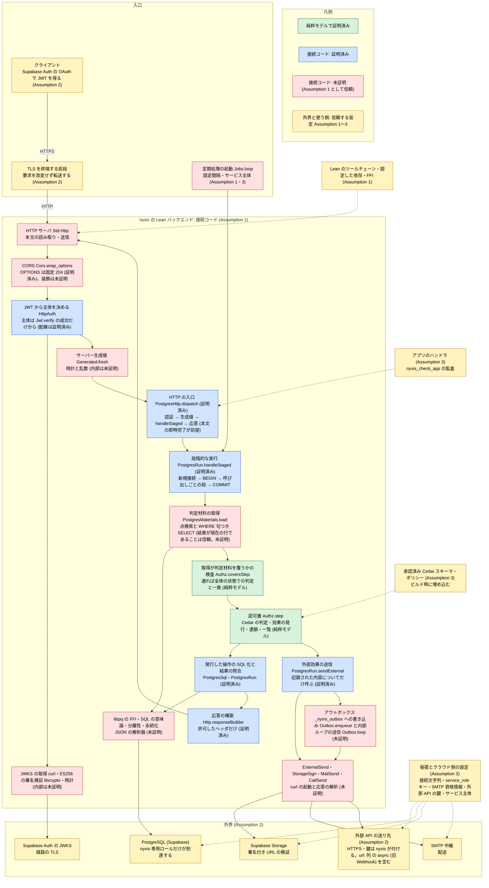

# ASSUMPTIONS — 証明の外側で信頼する仮定

nyxis の認可安全性の定理 `Nyxis.Runtime.authorization_safety`(`Nyxis/Runtime.lean`)は、「どのような HTTP リクエスト列が送られても、認証された主体の正当な権限を超えるデータの読み取り・変更・削除・権限付与は発生しない」をランタイムの純粋モデルの上で証明している。この文書は、その定理が実際の運用でも成り立つために証明の外側で信頼する仮定を 3 項目(Assumption 1〜3)に分けて列挙する。定理ごとに述べること・述べないことの目録は [docs/proofs.md](docs/proofs.md)、仮定を支える nyxis の作り(接続コードの責務。仮定でも証明でもない)は [docs/connection.md](docs/connection.md) にある。この文書は人間が管理する文書であり、仮定の追加・削除・再構成を含む修正は人間の判断で行う。

## 保証の範囲

HTTP の要求と定期処理の起動が入ってから DB・Supabase Storage・SMTP 中継・外部 API の送り先に届くまでの経路に、保証の 3 層を重ねた図。緑は純粋モデルで証明済み、青は接続コードのうち証明済み、赤は接続コードのうち未証明(Assumption 1 として信頼)、黄は外界と使う側についての信頼する仮定(Assumption 1 のライブラリ・ツールチェーン、Assumption 2、Assumption 3)。

- 緑(純粋モデルで証明済み): ルーティングからハンドラのアクション呼び出しごとの認可層の判定(cedar-spec の `Cedar.Spec.isAuthorized` そのもの)、効果の発行、状態の遷移、一覧、連鎖、外部効果の記録、ハンドラに渡る値まで。取得した行だけでの判定が、検査(`Authz.coversStep`)に通れば全体の状態での判定と一致すること(`Authz.step_eq_of_covers`)。下の「定理が述べること」。
- 青(接続コードの証明済み): 認証の成功から主体を作る配線、生成値を決めて要求を組み 1 トランザクションで段階的に実行し応答を構築する流れ、各段の検査と判定の記録、発行する SQL が認可済みの操作から生成されること、結果の照合、外部効果の送信を記録された内容についてだけ呼ぶこと、応答が要求と各段の結果列だけから再現でき(認可判定用の内部取得が応答へ渡る別の入力は無い)許可したヘッダだけを載せること。目録は docs/proofs.md。
- 赤(接続コードの未証明。Assumption 1 として信頼): HTTP の生の復号・本文の task・送信、JWKS 取得と署名検証と時計と乱数の内部、判定材料の取得(点検索と WHERE 句つき SELECT の結果が DB の現在の行であること、取得が必要な行をすべて引くこと。`PostgresRun.Chain` の前提)、SQL を PostgreSQL が実行したときの意味論・分離性・永続化、JSON の解析器と形状の構成、curl の起動と応答の解析、定期処理のスレッド、CORS の装飾後の応答。
- 黄(信頼する仮定): ツールチェーンとライブラリが正しいこと(Assumption 1)、外界が仮定どおりに振る舞うこと(Assumption 2)、アプリの開発・運用者が正しく活用すること(Assumption 3)。各項目は下に列挙する。

## 定理が述べること

`Nyxis.Runtime.authorization_safety` は、任意の App・初期状態・認証済み要求列(HTTP の要求と定期処理の起動。各要求は JWT から決めた主体 — 起動ではサービス主体 — と、nyxis が要求ごとに決めたサーバー生成値を伴う)について次を述べる。読み下しは `Nyxis/Runtime.lean`、各段の補題は docs/proofs.md。

- (1) 発行されたすべての DB 操作は、その要求の主体と生成値について、承認済みポリシーが permit したアクションの宣言された効果の範囲内にある。ハンドラは主体・時刻・ID を偽れない。
- (2) 状態(`Nyxis.Db.Store`)は記録された操作だけで変わり、各判定はその時点の状態に対して行われる(`Authz.Coherent`)。
- (3) ハンドラ(したがって応答)に渡った(主キー, 行)の組は、同じ要求で permit されたその主キーの読み取りがその時点の状態で指す行に限る(主キーと行の中身を別の行から組み合わせることもできない)。
- (4) 一覧の件数と返す行は、判定時の対象テーブルの行のうち問い合わせの絞り込みに合い permit された行だけから決まる(`Runtime.ListResult`)。上限と位置は permit された行に対して適用される。
- (5) 各記録を判定したアクションは、ハンドラの呼び出しのものか、正本が `@references` で宣言した連鎖の削除のものである(`Authz.ActionOrigin`)。
- (6) 記録されたすべての外部効果(署名付き URL の発行・メール・外部 API 呼び出し)は、その要求の主体と生成値について対象の行の読み取りと同じ判定材料で permit され、内容は行の宣言された列と生成値から nyxis が決めたものである(`Authz.ExternalAuthorized`)。
- (7) ハンドラに渡った署名付き URL には、その呼び出し(同じアクション・主キー・判定時の状態)についての上の外部効果の記録がある。
- (8) 記録されたすべての外部 API の呼び出し(sync・async とも)は、その要求の主体と生成値について対象の行の読み取りと同じ判定材料(提案値は `context.values`)で permit され、送り先・メソッド・パスは正本の宣言、本文は対象行の宣言された列と提案値から nyxis が決めたものである(`Authz.CallRecorded`)。アウトボックスの各行はこの記録そのものである(接続層 `PostgresRun.driver` が要求と同じトランザクションで `Nyxis.Internal.Outbox.enqueue` により書く。記録についてだけ書くことは `PostgresRun.StagedRun.external` の範囲、INSERT の内容と内部ループ `Outbox.loop` の送信・再試行は未証明で Assumption 1。統合テストは `scripts/check-outbox.py`)。
- (9) ハンドラに渡った応答の値(2xx の復号した値、または 2xx 以外の状態コードと本文)は判定(発行する操作・記録)を変えず、その呼び出しについて permit された記録がある(`Authz.step_external_indep`、`Runtime.trace_called`)。応答の値が DB に入る経路は、ハンドラが別アクションで提案する values だけで、(1) の判定を通る。接続層は 2xx の応答が宣言した型に合わなければ要求全体を固定の 502 にして取り消す(`PostgresRun.gatewayResponse`。`PostgresRun.handleStaged_success` の分岐)。模擬 API に対する統合テストは `scripts/check-external-calls.py`。

定理が述べないこと(仮定ではなく保証の範囲外): HTTP・JWT・SQL との対応(Assumption 1・2)、生成値の一意性と時計の正しさ(Assumption 1・2)、署名付き URL の中身と Storage の振る舞い(Assumption 2)、メール・外部 API の async の配送(`url: 列` の `async` が旧 Webhook)と、外部 API の応答の値の正しさ(Assumption 2)、sync の送信後に COMMIT が失敗した要求の送り先側の副作用(Assumption 3 の冪等キー)、サービス主体の ID と設定(Assumption 3)、permit / deny の観測を含む無条件の非干渉。一意性・参照整合の違反は permit された操作についてだけ `conflict`(409)になり何も発行しないが、permit された主体にはその 409 が同じ値の行や参照する行の存在を伝えうる(主キーの競合の 409 と同じ種類で、ハンドラに渡る行を述べる定理の外)。添付ファイルの内容はクライアントが署名付き URL で Storage と直接やりとりし nyxis を通らないので、内容の検査・ウイルス対策・容量の上限は Storage とアプリの責務で保証の外。承認済み正本の宣言から組んだ App については、上の結論がその宣言のスキーマ・ポリシーに相対的に成り立つ(`Nyxis.Approved.authorization_safety`)。ハンドラが主体・対象・効果を指定したり差し替えたりできないことは `Handler` の型と `Authz.step` の構造による(docs/connection.md「型と定義による性質」)。

## 信頼する仮定

3 項目それぞれを、仮定(何を信頼するか)/ 破られると何が起きるか / 開発者の守り方 / 検査(支える条件 ID と検査。仮定の成立を証明するものではなく、統合テストの成功を形式証明の代わりにしない)の 4 点で書く。「開発者」は nyxis でアプリケーションを作りデプロイして運用する人を指す。

### Assumption 1. 証明の外で動くコード

- **仮定**: 定理は Lean の項として検査されている。それを実行する次のコードが、検査した定理どおりに動くこと。
  - **nyxis の接続コード**(証明の外にある部分。将来証明して減らす): `Nyxis.Http`、`Nyxis.Internal.HttpAuth` / `SupabaseJwt` / `JwksFetch`、`Nyxis.Internal.PostgresHttp`、`Nyxis.Internal.Postgres` と `PostgresRun` 等の DB 層、`Nyxis.Internal.Cors`、`Nyxis.Internal.StorageSign` / `MailSend` / `CallSend` / `ExternalSend` / `Outbox`(`async` の呼び出しのアウトボックスへの書き込みと内部ループの送信・再試行)、`Nyxis.Internal.Jobs`、`Nyxis.Internal.ApprovedServer` が、モデルどおりに動くこと: リクエストを改変せず、主体を JWT だけから決め、操作を対象の行と列を超えずに伝え、外部効果を記録された内容についてだけ送り、nyxis が返したレスポンスだけを返す。証明済みの部分は docs/proofs.md に列挙して信頼から外す。残る未証明の対応は、HTTP の生の復号・本文の task の継続・送信、判定材料の取得(点検索と WHERE 句つき SELECT の結果が DB の現在の行とその絞り込みに合う行の全部であること、取得が判定の見る行をすべて引くこと。`PostgresRun.Chain` の前提で、定義によるだけで定理も実行時検査も無い)、SQL を PostgreSQL が実行したときの効果・分離性・永続化・rollback、JSON の解析器と `Map` の検索の意味論、正本からの形状(`PostgresShape`)の構成、JWKS の取得と JOSE・暗号・時計・乱数の内部、外部効果の送信の内部(`StorageSign` / `MailSend` / `CallSend` の curl の起動と応答の解析・復号)、Cedar 正本の解析が元ファイルの意図した構文・型を表すこと、定期処理のスレッド、外部 API 呼び出しの内部ループの間隔と再試行、CORS の装飾後の応答(理由は docs/proofs.md「接続コードに残る未証明の対応」)。人間の承認により当面この項目に含めるが、将来の証明対象から除外しない。
  - **Lean のツールチェーン**(版を固定して信頼): Lean 4 のカーネル(証明の検査)とコンパイラ、`elan` が解決するツールチェーン(`lean-toolchain`)、固定したリビジョンの依存(`lake-manifest.json` の cedar-lean と batteries、`scripts/dependencies.json` のリビジョンと SHA256 で固定した lean-pq と JWT 依存)。
  - **FFI とネイティブコード**(版を固定して信頼): `Std.Http` / `Std.Async` の内部(libuv 等)、PostgreSQL クライアント [lean-pq](https://github.com/typednotes/lean-pq) と libpq、JWT 用 OpenSSL の libcrypto とその Lean バインディング [lean-jose](https://github.com/paulbutcher/lean-jose) / [jose-libcrypto](https://github.com/paulbutcher/jose-libcrypto) / [lean-libcrypto](https://github.com/paulbutcher/lean-libcrypto)(推移依存 lean-json・leancrypto を含む)、JWKS の HTTPS 輸送と Storage への発行・外部 API 呼び出し・メール送信(SMTP(S))の curl/libcurl とその TLS バックエンド。
  - **暗号の実装**: JWT の署名検証に使う暗号(署名アルゴリズムの検証・ハッシュ)の実装が正しいこと。
- **破られると何が起きるか**: 定理を実行する機械(コンパイラ・ランタイム)と、外界(HTTP・JWT・PostgreSQL・Storage・SMTP)をモデルにつなぐ nyxis のコードは、証明の外にある。ここが宣言と違う操作(例: 更新で宣言外の列も書く、主体を JWT 以外から決める、記録に無い宛先へ送る)をすれば、証明された範囲を超える。署名検証の暗号が破られれば、誰でも任意の `sub` の JWT を作れる。
- **開発者の守り方**: ツールチェーンと依存のリビジョンを固定したまま(`lean-toolchain`・`lake-manifest.json`・`scripts/dependencies.json`。`python3 scripts/prepare-dependencies.py` が SHA256 を照合して取得する)、`lake build` で証明の検査(`Test/Axioms.lean`)を通したものだけをデプロイする。Linux へ配置するときは、配置先の環境で curl/OpenSSL/CA/libpq の版を固定し、JWKS 取得の検査(`scripts/check-jwks-fetch.py`)を実行する。lean-pq には承認済みの `scripts/patches/lean-pq-ownership.patch` だけを当てる。暗号の実装(ライブラリ・バインディング)の差し替えと自前実装は人間の判断に委ねる。
- **検査**: 証明の検査(`lake build` が exit 0 で、定理の公理が `propext` / `Classical.choice` / `Quot.sound` のみ)、接続コードの振る舞いの統合テスト(`scripts/check-sample-jwt-db.py`: 実サンプル・ローカル Supabase の Auth と専用 DB で、4 主体の許可・拒否・永続化、拒否後の行不変、署名が不正・期限切れ・発行者が異なる JWT の匿名化、JWKS 失敗時の匿名化と復旧、DB 障害時の rollback)、CORS(`scripts/check-cors.py`)、判定材料の取得範囲(`scripts/check-materials-scale.py`: 専用 DB が固定データだけの状態と User・Post に 10 万行を足した状態で同じ要求列を送り、`pg_stat_user_tables` / `pg_stat_user_indexes` で各要求が 10 万行のテーブルから読んだ行数が空の状態と同じで、応答時間の中央値が 2 倍以内)、拡張値の列(`scripts/check-postgres-values.py`: 段階的な経路と参照経路を別の実 DB で同じ期待値に照らす)、ハンドラに渡す要求の要約(`scripts/check-http-headers.py`)、`scripts/check-jwks-fetch.py`(取得の固定オプションと失敗時の匿名化)。接続不要の部分検査は `lakefile.lean` の検査用実行ファイルと `scripts/` の `check-*` スクリプト(注入ドライバ・実 libpq の接続拒否・起動時の設定拒否)。ツールチェーン・FFI・暗号の正しさ自体は検査できない。

### Assumption 2. クラウドと実行環境

- **仮定**: nyxis の外にある次のサービスと、バックエンドが走る機械の環境が、仕様どおりに振る舞うこと。各サービスの設定と秘密の管理は Assumption 3。
  - **Supabase Auth**: 発行する JWT の `sub` は、OAuth で本人確認を終えた利用者だけを指す。利用者本人以外に、その利用者の `sub` を持つ JWT は発行されない。
  - **PostgreSQL(Supabase)**: DB の内容(サンプルでは `User`・`Post` の各行)は、nyxis のバックエンドが専用ロールで発行する操作だけで変わる。Supabase の Data API(PostgREST / GraphQL)、他のロール、他のアプリケーションからは到達しない。
  - **Supabase Storage**: nyxis の求めに応じて発行した署名付き URL を正しく検証する。その URL でできるのは、発行を求めたオブジェクト(バケットと `テーブル/<主キー>/<名>` のパス)への、発行の種類(アップロード / ダウンロード)の操作だけで、有効期限(ダウンロードはコア設定で固定の 10 分。アップロードは Storage 側が決め、Supabase では 2 時間に固定)の後は使えず、他のオブジェクトやバケットには到達できない。
  - **前段の経路**: Lean バックエンドは平文の HTTP で待ち受けるので、その前に TLS を終端する前段(リバースプロキシ・ロードバランサー等)を置く。バックエンドにはその前段経由でしか到達できず、前段はリクエストを(Authorization ヘッダを含めて)改変せずにバックエンドへ渡し、レスポンスをそのまま返し、JWT を他へ漏らさない。前段にアプリケーションのロジックは無い。配置先の基盤と TLS 終端が正しく動く。
  - **SMTP 中継**: コア設定 `NYXIS_SMTP_URL`(中継の `smtps://[user:pass@]ホスト[:port]`。ローカルの Mailpit には `smtp://`)の SMTP 中継が、nyxis が渡したメッセージ(差出人 `NYXIS_MAIL_FROM`、宛先・件名・本文は permit された行の宣言された列の値)をその宛先にだけ配送する。配送の成否・到達・重複(中継以降)、メールの機密(中継以降の経路)は nyxis の保証の外。
  - **外部 API の送り先**: 正本の `@external` が名指す送り先(ベース URL は正本の宣言、`url: 列` の形では対象行の HTTPS の URL)が、nyxis の付けた認証ヘッダの鍵を nyxis のバックエンド以外へ漏らさず、受け取った内容(permit された対象行の宣言された列と提案値の JSON)をその API の仕様どおりに扱う。経路は Storage・SMTP と同じ curl/TLS/CA 信頼ストアが守る。送り先が応答として返す値の正しさ、async の配送の成否・到達・重複(最大試行回数までの再送で同じ内容が複数回届き得る)、sync の送信後に要求の COMMIT が失敗したときの送り先側の副作用は nyxis の保証の外。
  - **経路の TLS**: Supabase の公開鍵(JWKS)を取得する経路と、クライアント・前段・バックエンド・Supabase(Auth・DB・Storage)・SMTP 中継の間の経路を TLS が守る。環境の curl の実行ファイルと CA 信頼ストアが正しく管理されている。
  - **時計と乱数**: JWT の有効期限の判定、サーバー生成値の現在時刻(ポリシーが `context.now` で判定する期限や作成日時)、定期処理の起動の時刻と間隔に使う機械の時計が正しい。生成する一意 ID の乱数の源が偏らない。
- **破られると何が起きるか**: 定理の「認証された主体」は、リクエストの JWT を検証して得た `sub` のユーザーである(`Runtime.AuthenticatedRequest.principal`)。Supabase Auth が JWT を他人に発行すれば、nyxis はその他人を本人として扱い、証明はこれを区別できない。定理は DB の状態を純粋モデル `Store` で表し、状態は記録された操作だけで変わることを証明している(`Authz.Coherent`)。nyxis 以外の経路で行が変われば(例: Data API で `admin` 列を true にする、他人の下書きを読む)、それはモデルの外の操作である。Storage が求めと違う対象に使える URL を返したり期限を守らなければ、認可の判定を経ない到達が起きる。前段が JWT を付け替えたり本文を書き換えたりすれば、主体やリクエストの内容がクライアントの送ったものでなくなり、バックエンドに直接到達する経路があれば TLS 終端の外で平文の HTTP が露出する。公開鍵の取得経路が差し替えられれば攻撃者の鍵で署名した JWT が通り、TLS が無ければ経路上で JWT が盗まれ再利用される。時計が狂えば期限切れの JWT を受け入れるおそれがあり、`context.now` の値が実時刻とずれる。中継や送り先が記録どおりに扱わなくても nyxis は検知できない(nyxis が保証するのは「permit されない送信は発行されない」ことで、配送の成否ではない)。
- **開発者の守り方**: 発行者(Supabase プロジェクトの HTTPS URL + `/auth/v1`)をコア設定 `NYXIS_SUPABASE_ISSUER` で渡す。JWKS の URL はそこから固定導出され、要求の URL・ヘッダ・トークンは接続先に影響しない。`NYXIS_STORAGE_URL`(Supabase プロジェクトの HTTPS URL)と `NYXIS_SMTP_URL`(本番は `smtps://`)も固定の接続先として渡す。curl 8.4 以降を使い、証明書・ホスト名検証と CA 信頼設定を維持する。時計は NTP 等で同期し、運用環境の時刻同期状態を確認する。前段は経路だけを担い、ヘッダや本文を書き換えない。
- **検査**: 署名が不正・期限切れ・発行者が異なる JWT を付けたリクエストが匿名として扱われること(`scripts/check-sample-jwt-db.py`)、`scripts/check-jwks-fetch.py`、添付(`scripts/check-team-docs.py`: ローカル Supabase の Storage に対し、2 つめの公式サンプルで、添付の URL 発行がポリシーの許可する主体だけに成立し、許可しない主体には 403 で Storage への求めが発生せず、発行された URL でアップロードとダウンロードができ、別のオブジェクトには使えないこと)、メール送信(同スクリプト: ローカル Supabase の Mailpit の SMTP に対し、文書の共有時にポリシーが許可する購読者だけへメールが送られ、許可しない送信は発生せず、捕捉したメールの宛先・件名・本文・差出人が行の列と設定どおりであること。`Test/External.lean`: 正本の受理と拒否、内容が行の列から決まること。外部 API 呼び出しは `scripts/check-external-calls.py`(ローカルの模擬 HTTPS API に対し、deny された呼び出しは送られず、認証ヘッダがコア設定の値で付き、余分なキーが捨てられ、欠落・型違いが 502 で取り消され、2xx 以外がハンドラに渡り、鍵が応答・出力・DB に現れないこと)。2 つめのサンプルへの導入は `scripts/check-team-docs.py`(正本の送り先 Summarizer / Audit への `sync` / `async` の呼び出し))。Auth が本人にだけ発行すること、暗号・TLS・時計の値、到達経路の限定、Storage の署名の検証そのもの、中継の配送は検査できない。外部 API の送り先は `scripts/check-external-calls.py`・`scripts/check-outbox.py`(ローカルの模擬 API に対し、permit された `async` の呼び出しが要求と同じトランザクションで記録されて COMMIT の後に内部ループが送り、5xx と輸送の失敗は指数バックオフで再試行し、4xx と最大試行回数超過は `failed` で残り、2 プロセスで同じ行を 2 度送らないこと)・`scripts/check-team-docs.py`(ローカルの模擬 API に対し、2 つめの公式サンプルで、要約の `sync` の呼び出しがポリシーの許可する主体だけに成立して応答が別のアクションの判定を通って列に記録され、空の要約は拒まれ、許可しない主体には 403 で送信が発生せず、文書の更新の `async` の通知がアウトボックスを経て届くこと)。送り先の振る舞いそのものは検査できない。設定の検査は Assumption 3 にある。

### Assumption 3. アプリの開発・運用者の正しい活用

- **仮定**: nyxis でアプリケーションを作り、デプロイして運用する開発者が次を守ること。
  - **承認した Cedar 正本**: デプロイされるバックエンドが使う Cedar スキーマ(効果の宣言を含み、テーブル定義を兼ねる)とポリシーは、開発者が読んで承認したものと同一である(サンプルでは `examples/bulletin-board/backend/schema.cedarschema` と `examples/bulletin-board/backend/policies.cedar`)。
  - **アプリケーションのコード**: アプリの Lean コードは `unsafe`・`@[implemented_by]`・`@[extern]`・`sorry` を含まず、ビルド時の任意の IO(`#eval`・`run_cmd`、elaborator 等)で秘密を読み込んだり、検査や環境を改変したりしない。アプリ側の `main` は引数の処理・起動情報の表示・nyxis の起動に限る。検査コマンド `nyxis_check_app` を含む最終モジュールをビルドしてデプロイする。検出できる禁止事項はビルド時に拒否するが、検査に到達する前のビルド過程の IO、定数を残さないコマンド、検査後に追加したコードや検査を外したビルド、`main` の IO の内容は防げず信頼する(完全な隔離の保証とはしない)。禁止リストの網羅性は未証明で、検査器自身は Assumption 1 の未証明コードである。
  - **デプロイするもの**: 承認した正本と監査を通したコードから `lake build` で証明の検査を通したものだけをデプロイする。
  - **秘密の秘匿**: DB 接続文字列 `NYXIS_DATABASE_URL`、Storage の service_role キー `NYXIS_STORAGE_SERVICE_KEY`、SMTP の資格情報(`NYXIS_SMTP_URL` に含む)、外部 API の送り先ごとの鍵(`NYXIS_EXT_<名前>`)、サービス主体の設定 `NYXIS_SERVICE_PRINCIPAL`・`NYXIS_JOB_INTERVAL_SECONDS`、Supabase プロジェクトの署名鍵・アクセストークン、配置先の資格情報が、nyxis のバックエンドと運用者以外に漏れない。sync で副作用のある API を呼ぶアプリは要求の一意 ID(`context.id`)を冪等キーとして本文に載せ、送り先がそれを尊重する。
  - **クラウド側の設定**: Supabase Auth の認証手段を OAuth のみにし、email/phone 認証を無効にする。Supabase の Data API を無効化し、他のロールの資格情報を配らない。バックエンドの HTTP のポートを前段以外に公開しない。添付のバケット(`NYXIS_STORAGE_BUCKET`)を非公開にし、Storage の RLS / バケットの設定で anon キーからの到達を許さない。サービス主体は、正本が `entity Service;` を宣言するアプリでだけ設定する(宣言しないアプリでは起動時に拒まれる)。
- **破られると何が起きるか**: 定理は「どのスキーマ・ポリシーでも」成り立つが、「正当な権限」の中身はスキーマとポリシーが決める。承認していないポリシーがデプロイされれば、証明は成り立ったまま、意図しない権限が「正当」になる。`Handler` のモデルは `pure` と `call` だけから成るが、Lean のコンパイラが純粋な定数に与える実装にはデバッグ出力等もあり、実装差し替えやビルド時 IO はカーネルの型の検査だけでは防げず、ハンドラが認可層を通らずに DB や外界へ到達できる。秘密が漏れれば nyxis を通らずに到達できる: 接続文字列なら DB の全行、service_role キーなら Storage のすべてのオブジェクト、SMTP の資格情報なら任意のメールの送信、外部 API の鍵なら nyxis を通らずに同じ API の呼び出し、サービス主体の設定を書き換えられればポリシーがサービス主体に許した範囲の操作。宛先や `url: 列` の送り先の列に書ける値をポリシーで絞らなければ、permit された送信が意図しない相手へ届く(アプリが列に何を書けるかは、そのアプリの挿入・更新の効果とポリシーが決める)。クラウド側の設定が外れれば、Assumption 2 の前提(OAuth で本人確認を終えた利用者だけの JWT、nyxis 専用ロールだけの DB、前段経由だけの到達、署名付き URL だけの Storage)が成り立たない。冪等キーを使わずに sync で副作用のある API を呼ぶと、送信後に COMMIT が失敗した要求の副作用が外部に残る。
- **開発者の守り方**: スキーマとポリシーをリポジトリで管理し、変更は人間が承認する。承認した 2 ファイルを `nyxis_approved` で宣言し、Lake の `input_file` / `needs` に登録して変更を再ビルドへ反映する。型は「人間が承認した」ことまでは証明せず、宣言した 2 ファイルを承認するのは開発者の責務である。全アプリモジュール(宣言 `Approved` を含む)を import した最終モジュールの末尾に `nyxis_check_app` を置き、起動処理(`Main`・構築用の `InitDatabase`)はその最終モジュールを import してから `Nyxis.Internal.*` に触れる。起動モジュールをハンドラから import しない。`lake build` と `sh scripts/check-handler-effects.sh` を通す。別の抜け道が見つかれば機構で塞ぐか、追加の信頼が必要なら人間に確認し、黙って仮定を拡張しない。秘密はすべて環境変数で渡し、リポジトリに置かない。ローカル統合検査の管理 API によるマジックリンクは、利用者向けのクラウド設定と区別する。ポリシーでは、宛先の列に書ける値(例: 購読者本人だけが自分の宛先を書ける)、外部 API の `url: 列` の送り先(`like "https://<信頼するホスト>/*"` の形。旧 Webhook と同じ)、サービス主体に許す操作(例: 送信済みでない通知の一覧と送信だけ)を最小に絞り、メールの内容の列には、その効果の対象の行を読める主体にしか見せない情報だけを置く。副作用のある外部 API は async にするか、sync なら `context.id` を冪等キーに使う。応答の値をそのまま認可に使わず、DB に書くときは挿入・更新のポリシーで検査する。
- **検査**: `cedar validate` が exit 0、正本の拒否(効果の無いアクションや、無いテーブル・列を参照する効果を `lake build` が拒む。`scripts/check-schema-rejection.sh`)、`scripts/check-approved-binding.py`(宣言と異なる well-typed な入力を起動のビルドが拒む)、`scripts/check-approved-declaration.py`(リポジトリ外の正本・別の主体型でも同じ配線が通り、監査前の内部モジュールの import は拒まれる)、ハンドラの効果の制限(`scripts/check-handler-effects.sh`: 型エラーの変種と、型は通るが監査が拒む変種の `lake build` が非 0 で終わり、復元した正本がビルドでき、アプリ側のコードに禁止語が無い)、パスワード認証の無効化(本物の Supabase プロジェクトで、パスワードによるサインアップ・サインインが非 2xx)、Data API の閉鎖(本物の Supabase プロジェクトで、anon キーと認証済みユーザーの JWT による `GET /rest/v1/<テーブル>` が非 2xx)、サービス主体(`scripts/check-team-docs.py`: 設定のサービス主体の ID を 1 人の Auth 利用者の ID と同じにしても、その利用者の JWT による要求はサービス主体の権限を持たず(403)、定期処理はサービス主体としてポリシーの範囲内の操作だけを行うこと。`Test/External.lean`: サービス主体は `principal is Service` に許したアクションだけ permit され、定期処理の起動は同じ `runHandler` の経路で記録を残すこと)、外部 API の鍵(`scripts/check-external-calls.py`: Authorization の値が記録・ログ・応答に現れない)。承認そのもの、秘密の秘匿(外部 API の鍵を含む)、ビルドしたものを配置する行為は人間の行為で、検査できない。

## 来歴

- 2026-10-14: この文書の範囲を人間が承認。A2 に JWT の期限判定の時計を含める。A4 に nyxis 自身の証明外の接続コード(当面。実現可能な部分は将来証明する)と、JWT 用 OpenSSL の libcrypto とその Lean バインディングを含める。A7 は検出できる禁止事項をビルド時に拒み、残るビルド時 IO と `main` を信頼する方針。信頼する箇所と残る仮定はこの文書に集約し、証明の目録は docs/proofs.md に分離する。PostgreSQL クライアントに lean-pq を採用。
- 2026-10-15: JWKS の HTTPS 輸送に curl を採用し、A2・A4 に curl/libcurl・TLS バックエンド・CA 信頼ストアと環境の実行ファイル・CA 設定を具体化。lean-pq の同じ固定版への所有権パッチを承認。
- 2026-10-18: 利用者向けの認証手段を OAuth のみとし、email/phone 認証を無効化(A1 の守り方)。
- 2026-10-21: 承認済み正本への結合を、アプリケーション側の宣言(`nyxis_approved`)から App を組む形に変更(A6・A7 の守り方。新たな仮定は無い)。curl の版の確認を起動時 1 回に変更。
- 2026-10-23: 添付・通知・サービス主体の裁定に伴い A8(Supabase Storage)・A9(メール送信)・A10(サービス主体)の 3 項目を追加承認。Storage への発行と Webhook は同じ承認済み curl の HTTPS、メール送信は同じ curl の SMTP(S)。
- 2026-10-25: 各項目を「仮定 / 破られると何が起きるか / 開発者の守り方 / 検査」の 4 点に揃え、nyxis の作り(責務)の説明を docs/connection.md へ、接続コードに残る未証明の対応の理由を docs/proofs.md へ移し、保証の 3 層の図を加えた(仮定の追加・削除は無い)。
- 2026-10-25: 人間の指示で、旧 A1〜A10 の 10 項目を 3 項目(Assumption 1〜3)に再構成した。仮定の内容の追加・削除は無く、振り分けだけを行った。以後この文書は人間が管理する。旧番号との対応は次のとおり(「仮定」はそのサービスや部品が仕様どおりに振る舞うこと、「守り方」はその設定と秘密)。
- 2026-10-25: 外部 API 呼び出しの設計(docs/external-calls.md の D1〜D12)を反映。新しい項目を増やさず Assumption 1〜3 に振り分け、応答の値と async の配送は「定理が述べないこと」へ。Webhook は call の async(url: 列)に吸収して廃止する。
- 2026-10-25〜26: 外部 API 呼び出しを実装した(正本の `@external` と `call`、純粋モデルの (8)(9) の証明 `Runtime.trace_call` / `trace_called`、`sync` の送信 `Nyxis.Internal.CallSend`、アウトボックス `Nyxis.Internal.Outbox`、2 つめのサンプルへの導入)。旧 WebhookSend.lean は削除。未実装の注記は残っていない。
- 2026-10-26: 人間の指示で、公式サンプルの Cloudflare への配置資産を削除した。それに合わせて、Assumption 2 の「Cloudflare」を配置先を問わない「前段の経路」に、Assumption 3 の Cloudflare の API トークンとコンテナの非公開を配置先の資格情報とバックエンドのポートの非公開に一般化した(仮定の内容は同じ)。

| 旧 | 新 |
|---|---|
| A1 Supabase Auth | Assumption 2(仮定)、Assumption 3(OAuth のみの設定・鍵の秘匿) |
| A2 暗号プリミティブと TLS・時計 | Assumption 1(暗号の実装)、Assumption 2(TLS・時計・CA 信頼ストア) |
| A3 DB への到達は専用ロールだけ | Assumption 2(仮定)、Assumption 3(Data API 無効・接続文字列の秘匿) |
| A4 ツールチェーン・ランタイム・FFI | Assumption 1 |
| A5 Cloudflare の経路 | Assumption 2(仮定)、Assumption 3(コンテナ非公開・API トークンの秘匿) |
| A6 承認済み Cedar 正本 | Assumption 3 |
| A7 アプリのコード | Assumption 3 |
| A8 Supabase Storage | Assumption 2(仮定)、Assumption 3(バケット非公開・service_role キーの秘匿) |
| A9 メール送信・Webhook | Assumption 2(仮定)、Assumption 3(資格情報の秘匿・ポリシーで宛先と URL を絞る) |
| A10 サービス主体 | Assumption 3(設定と権限)、Assumption 2(定期処理の時計) |
| 外部 API 呼び出し(2026-10-25、設計文書の A11 案) | Assumption 1(接続コード・内部ループ)、Assumption 2(送り先の振る舞い・TLS)、Assumption 3(鍵の秘匿・冪等キー・url: 列 の絞り込み) |
