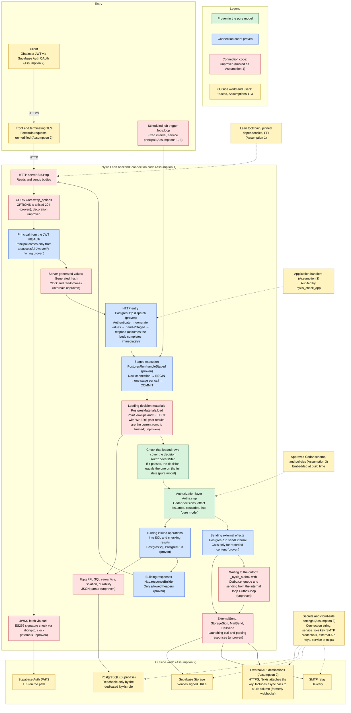

# ASSUMPTIONS — What Is Trusted Outside the Proof

English | [日本語](ASSUMPTIONS.ja.md)

> [!NOTE]
> This is an English translation of [ASSUMPTIONS.ja.md](ASSUMPTIONS.ja.md). The Japanese version is authoritative, and the project's checks run against it. If the two differ, follow the Japanese version.

Nyxis's authorization safety theorem `Nyxis.Runtime.authorization_safety` (`Nyxis/Runtime.lean`) proves, on a pure model of the runtime, that "no sequence of HTTP requests can cause an authenticated principal to read, modify, delete, or grant access to data beyond its legitimate permissions." This document lists, in three items (Assumptions 1–3), what is trusted outside the proof for that theorem to hold in actual operation. The catalog of what each theorem states and does not state is in [docs/proofs.md](docs/proofs.md). How Nyxis is built to uphold these assumptions (the responsibilities of the connection code, which are neither assumptions nor proofs) is in [docs/connection.md](docs/connection.md). This document is maintained by humans, and any change to it, including adding, removing, or restructuring assumptions, is made at human discretion.

## Scope of the guarantee

The diagram overlays the three layers of the guarantee on the path from an incoming HTTP request or scheduled-job trigger to the database, Supabase Storage, the SMTP relay, and external API destinations. Green is proven in the pure model, blue is connection code that is proven, red is connection code that is not proven (trusted as Assumption 1), and yellow is what is trusted about the outside world and the people using Nyxis (the libraries and toolchain of Assumption 1, Assumption 2, and Assumption 3).

- Green (proven in the pure model): everything from routing, through the authorization layer's decision on each action call made by a handler (exactly cedar-spec's `Cedar.Spec.isAuthorized`), effect issuance, state transitions, lists, cascades, and recording of external effects, up to the values passed to handlers. A decision made only on the loaded rows equals the decision on the full state whenever the check (`Authz.coversStep`) passes (`Authz.step_eq_of_covers`). See "What the theorem states" below.
- Blue (connection code, proven): the wiring that builds the principal from successful authentication; the flow that fixes the generated values, assembles the request, runs it in stages within one transaction, and builds the response; the checks at each stage and the recording of decisions; that issued SQL is generated from authorized operations; result checking; that external effects are sent only for recorded content; and that the response can be reproduced from the request and the sequence of stage results alone (internal reads made for authorization decisions have no other path into the response) and carries only allowed headers. The catalog is in docs/proofs.md.
- Red (connection code, unproven; trusted as Assumption 1): raw HTTP decoding, the body task, and sending; the internals of JWKS fetching, signature verification, the clock, and randomness; loading decision materials (that the results of point lookups and SELECT with WHERE are the current rows in the database, and that loading fetches every row needed, which is the premise of `PostgresRun.Chain`); the semantics, isolation, and durability of SQL as executed by PostgreSQL; the JSON parser and shape construction; launching curl and parsing its responses; the scheduled-job thread; and the CORS-decorated response.
- Yellow (trusted assumptions): that the toolchain and libraries are correct (Assumption 1), that the outside world behaves as assumed (Assumption 2), and that application developers and operators use Nyxis correctly (Assumption 3). Each item is listed below.

## What the theorem states

`Nyxis.Runtime.authorization_safety` states the following for any App, any initial state, and any sequence of authenticated requests (HTTP requests and scheduled-job triggers; each request carries the principal determined from the JWT, or the service principal for a trigger, and the server-generated values Nyxis fixed for that request). The plain-language reading is in `Nyxis/Runtime.lean`, and the lemmas for each stage are in docs/proofs.md.

- (1) Every issued database operation is within the declared effect of an action that the approved policies permitted for that request's principal and generated values. Handlers cannot forge the principal, the time, or IDs.
- (2) The state (`Nyxis.Db.Store`) changes only through recorded operations, and each decision is made against the state at that moment (`Authz.Coherent`).
- (3) Every (primary key, row) pair passed to a handler (and therefore to the response) is the row that a read of that primary key, permitted in the same request, points to in the state at that moment (a primary key cannot be combined with the contents of a different row).
- (4) The count and rows returned by a list are determined only by the rows of the target table at decision time that match the query's filter and are permitted (`Runtime.ListResult`). The limit and offset apply to the permitted rows.
- (5) The action under which each record was decided is either one called by the handler or a cascading delete declared with `@references` in the approved sources (`Authz.ActionOrigin`).
- (6) Every recorded external effect (issuing a signed URL, sending email, calling an external API) is permitted for that request's principal and generated values on the same decision materials as a read of the target row, and its content is determined by Nyxis from the row's declared columns and the generated values (`Authz.ExternalAuthorized`).
- (7) Every signed URL passed to a handler has the external-effect record above for that call (the same action, primary key, and state at decision time).
- (8) Every recorded external API call (both sync and async) is permitted for that request's principal and generated values on the same decision materials as a read of the target row (with proposed values in `context.values`). Its destination, method, and path come from the declarations in the approved sources, and its body is determined by Nyxis from the target row's declared columns and the proposed values (`Authz.CallRecorded`). Each outbox row is exactly such a record (the connection layer `PostgresRun.driver` writes it with `Nyxis.Internal.Outbox.enqueue` in the same transaction as the request. That it writes only for records is within the scope of `PostgresRun.StagedRun.external`; the content of the INSERT and the sending and retrying by the internal loop `Outbox.loop` are unproven and fall under Assumption 1. The integration test is `scripts/check-outbox.py`).
- (9) A response value passed to a handler (the decoded value of a 2xx response, or the status code and body of a non-2xx response) does not change any decision (the operations issued or the records made), and there is a permitted record for that call (`Authz.step_external_indep`, `Runtime.trace_called`). The only way a response value reaches the database is through values the handler proposes in a separate action, which go through the decision in (1). If a 2xx response does not match the declared type, the connection layer turns the whole request into a fixed 502 and rolls it back (`PostgresRun.gatewayResponse`, a branch of `PostgresRun.handleStaged_success`). The integration test against a mock API is `scripts/check-external-calls.py`.

What the theorem does not state (outside the guarantee rather than assumptions): the correspondence with HTTP, JWT, and SQL (Assumptions 1, 2); the uniqueness of generated values and the correctness of the clock (Assumptions 1, 2); the contents of signed URLs and the behavior of Storage (Assumption 2); the delivery of email and of async external API calls (an `async` call to a `url:` column is what used to be a webhook) and the correctness of values returned by external APIs (Assumption 2); side effects at the destination for a request whose COMMIT fails after a sync call was sent (the idempotency key of Assumption 3); the ID and configuration of the service principal (Assumption 3); and unconditional noninterference, including observation of permit and deny. A uniqueness or referential-integrity violation results in `conflict` (409) with nothing issued, but only for permitted operations; that 409 can still reveal to the permitted principal that a row with the same value, or a referenced row, exists (the same kind of leak as a 409 for a primary-key conflict, and outside the theorem about rows passed to handlers). Attachment contents travel directly between the client and Storage via signed URLs without passing through Nyxis, so content inspection, virus scanning, and size limits are the responsibility of Storage and the application and outside the guarantee. For an App built from the declaration of approved sources, the conclusions above hold relative to that declaration's schema and policies (`Nyxis.Approved.authorization_safety`). That handlers cannot specify or substitute the principal, the resource, or the effect follows from the type of `Handler` and the structure of `Authz.step` (docs/connection.md, "Properties from types and definitions").

## Trusted assumptions

Each of the three items is written in four parts: the assumption (what is trusted), what happens if it is broken, how developers uphold it, and checks (the supporting condition IDs and checks. These do not prove that the assumption holds, and a passing integration test is never a substitute for a formal proof). "Developer" means the person who builds an application with Nyxis, deploys it, and operates it.

### Assumption 1. Code that runs outside the proof

- **Assumption**: The theorem is checked as a Lean term. The following code that executes it behaves as the checked theorem says.
  - **Nyxis connection code** (the parts outside the proof, to be reduced by future proofs): `Nyxis.Http`, `Nyxis.Internal.HttpAuth` / `SupabaseJwt` / `JwksFetch`, `Nyxis.Internal.PostgresHttp`, the database layer including `Nyxis.Internal.Postgres` and `PostgresRun`, `Nyxis.Internal.Cors`, `Nyxis.Internal.StorageSign` / `MailSend` / `CallSend` / `ExternalSend` / `Outbox` (writing `async` calls to the outbox and sending and retrying them from the internal loop), `Nyxis.Internal.Jobs`, and `Nyxis.Internal.ApprovedServer` behave as the model does: they do not alter requests, determine the principal only from the JWT, pass on operations without exceeding the target rows and columns, send external effects only for recorded content, and return only the responses Nyxis produced. The proven parts are listed in docs/proofs.md and removed from what is trusted. The remaining unproven correspondences are: raw HTTP decoding, continuation of the body task, and sending; loading decision materials (that the results of point lookups and SELECT with WHERE are the current rows in the database and all rows matching the filter, and that loading fetches every row the decision looks at; this is the premise of `PostgresRun.Chain`, which rests on definitions alone with neither a theorem nor a runtime check); the effects, isolation, durability, and rollback of SQL as executed by PostgreSQL; the semantics of the JSON parser and of `Map` lookups; construction of shapes (`PostgresShape`) from the approved sources; the internals of JWKS fetching, JOSE, cryptography, the clock, and randomness; the internals of sending external effects (launching curl and parsing and decoding its responses in `StorageSign` / `MailSend` / `CallSend`); that parsing the Cedar sources represents the intended syntax and types of the original files; the scheduled-job thread; the interval and retries of the internal loop for external API calls; and the CORS-decorated response (the reasons are in docs/proofs.md, "Unproven correspondences remaining in the connection code"). By human approval these are included in this item for now, but they are not excluded from future proof work.
  - **Lean toolchain** (trusted at pinned versions): the Lean 4 kernel (which checks proofs) and compiler, the toolchain resolved by `elan` (`lean-toolchain`), and the dependencies pinned at fixed revisions (cedar-lean and batteries in `lake-manifest.json`; lean-pq and the JWT dependencies pinned by revision and SHA256 in `scripts/dependencies.json`).
  - **FFI and native code** (trusted at pinned versions): the internals of `Std.Http` / `Std.Async` (libuv and so on); the PostgreSQL client [lean-pq](https://github.com/typednotes/lean-pq) and libpq; OpenSSL's libcrypto for JWT and its Lean bindings [lean-jose](https://github.com/paulbutcher/lean-jose) / [jose-libcrypto](https://github.com/paulbutcher/jose-libcrypto) / [lean-libcrypto](https://github.com/paulbutcher/lean-libcrypto) (including the transitive dependencies lean-json and leancrypto); and curl/libcurl and its TLS backend, used for the HTTPS transport of JWKS, issuing to Storage, external API calls, and sending email (SMTP(S)).
  - **Cryptographic implementations**: the implementations of the cryptography used to verify JWT signatures (signature algorithm verification and hashing) are correct.
- **If it is broken**: The machinery that executes the theorem (compiler and runtime) and the Nyxis code that connects the outside world (HTTP, JWT, PostgreSQL, Storage, SMTP) to the model are outside the proof. If they perform operations that differ from what is declared (for example, writing undeclared columns in an update, determining the principal from something other than the JWT, or sending to a recipient that was not recorded), the behavior goes beyond what was proven. If the cryptography for signature verification is broken, anyone can forge a JWT with any `sub`.
- **How developers uphold it**: Keep the toolchain and dependency revisions pinned (`lean-toolchain`, `lake-manifest.json`, `scripts/dependencies.json`; `python3 scripts/prepare-dependencies.py` fetches them and verifies their SHA256), and deploy only what has passed the proof check (`Test/Axioms.lean`) in `lake build`. When deploying to Linux, pin the versions of curl, OpenSSL, CA certificates, and libpq in the target environment and run the JWKS fetch check (`scripts/check-jwks-fetch.py`) there. Apply only the approved `scripts/patches/lean-pq-ownership.patch` to lean-pq. Replacing the cryptographic implementations (libraries or bindings) or implementing them in-house is left to human judgment.
- **Checks**: the proof check (`lake build` exits 0, and the theorem's axioms are only `propext` / `Classical.choice` / `Quot.sound`); the integration test of the connection code's behavior (`scripts/check-sample-jwt-db.py`: on the real sample with local Supabase Auth and a dedicated database, permits, denials, and persistence for four principals; rows unchanged after a denial; requests with JWTs that have a bad signature, are expired, or come from a different issuer treated as anonymous; anonymization on JWKS failure and recovery; rollback on database failure); CORS (`scripts/check-cors.py`); the loading scope of decision materials (`scripts/check-materials-scale.py`: the same sequence of requests is sent with the dedicated database holding only fixed data and with 100,000 rows added to User and Post, and `pg_stat_user_tables` / `pg_stat_user_indexes` confirm that each request reads the same number of rows from the 100,000-row tables as in the empty state, with median response time within 2×); extended-value columns (`scripts/check-postgres-values.py`: the staged path and the reference path are checked against the same expected values on separate real databases); the request summary passed to handlers (`scripts/check-http-headers.py`); and `scripts/check-jwks-fetch.py` (the fixed fetch options and anonymization on failure). Partial checks that need no connection are the check executables in `lakefile.lean` and the `check-*` scripts in `scripts/` (injected drivers, connection refusal with real libpq, rejection of configuration at startup). The correctness of the toolchain, FFI, and cryptography themselves cannot be checked.

### Assumption 2. Cloud services and the runtime environment

- **Assumption**: The following services outside Nyxis, and the environment of the machine running the backend, behave as specified. Configuration and secret management for each service fall under Assumption 3.
  - **Supabase Auth**: The `sub` of an issued JWT refers only to a user who has completed identity verification via OAuth. No one other than that user is issued a JWT with that user's `sub`.
  - **PostgreSQL (Supabase)**: The contents of the database (in the sample, the rows of `User` and `Post`) change only through operations the Nyxis backend issues with its dedicated role. They are not reachable from Supabase's Data API (PostgREST / GraphQL), other roles, or other applications.
  - **Supabase Storage**: It correctly verifies the signed URLs issued at Nyxis's request. Such a URL allows only the kind of operation it was issued for (upload or download) on the object it was requested for (the bucket and the path `table/<primary key>/<name>`); it cannot be used after it expires (downloads use a fixed 10 minutes set in the core configuration; uploads are decided by Storage, fixed at 2 hours on Supabase); and it cannot reach other objects or buckets.
  - **The path in front**: The Lean backend listens on plain HTTP, so a front end that terminates TLS (a reverse proxy, load balancer, or similar) sits in front of it. The backend is reachable only through that front end. The front end passes requests to the backend without modification (including the Authorization header), returns responses as they are, and does not leak JWTs. The front end contains no application logic. The hosting infrastructure and TLS termination work correctly.
  - **SMTP relay**: The SMTP relay given by the core setting `NYXIS_SMTP_URL` (`smtps://[user:pass@]host[:port]` for the relay; `smtp://` for local Mailpit) delivers the messages Nyxis hands it (sender `NYXIS_MAIL_FROM`; recipient, subject, and body are the values of the declared columns of a permitted row) only to their recipients. Whether delivery succeeds, arrives, or is duplicated (beyond the relay), and the confidentiality of email (on the path beyond the relay), are outside Nyxis's guarantee.
  - **External API destinations**: A destination named by `@external` in the approved sources (the base URL is declared in the sources; in the `url: column` form, it is the HTTPS URL in the target row) does not leak the key in the authentication header Nyxis attaches to anyone other than the Nyxis backend, and handles what it receives (JSON of the declared columns of the permitted target row and the proposed values) according to that API's specification. The path is protected by the same curl, TLS, and CA trust store as Storage and SMTP. The correctness of values the destination returns in its responses; whether async delivery succeeds, arrives, or is duplicated (resends up to the maximum number of attempts can deliver the same content more than once); and side effects at the destination when a request's COMMIT fails after a sync call was sent are outside Nyxis's guarantee.
  - **TLS on the path**: TLS protects the path used to fetch Supabase's public keys (JWKS) and the paths between the client, the front end, the backend, Supabase (Auth, database, Storage), and the SMTP relay. The curl executable and CA trust store in the environment are properly managed.
  - **Clock and randomness**: The machine clock used to judge JWT expiry, for the current time among the server-generated values (deadlines and creation times that policies judge with `context.now`), and for the timing and interval of scheduled-job triggers is correct. The source of randomness for generated unique IDs is unbiased.
- **If it is broken**: The theorem's "authenticated principal" is the user of the `sub` obtained by verifying the request's JWT (`Runtime.AuthenticatedRequest.principal`). If Supabase Auth issues a JWT to someone else, Nyxis treats that person as the user, and the proof cannot tell the difference. The theorem represents the database state with the pure model `Store` and proves that the state changes only through recorded operations (`Authz.Coherent`). If rows change through a path other than Nyxis (for example, setting the `admin` column to true through the Data API, or reading someone else's draft), that is an operation outside the model. If Storage returns URLs usable on objects other than those requested, or does not enforce expiry, access happens without an authorization decision. If the front end swaps the JWT or rewrites the body, the principal or request content is no longer what the client sent, and if there is a path that reaches the backend directly, plain HTTP is exposed outside TLS termination. If the path used to fetch public keys is replaced, JWTs signed with an attacker's key are accepted, and without TLS, JWTs can be stolen on the path and replayed. If the clock is wrong, expired JWTs may be accepted and the value of `context.now` drifts from real time. If the relay or a destination does not handle messages as recorded, Nyxis cannot detect it (what Nyxis guarantees is that no unpermitted send is issued, not that delivery succeeds).
- **How developers uphold it**: Pass the issuer (the Supabase project's HTTPS URL + `/auth/v1`) in the core setting `NYXIS_SUPABASE_ISSUER`. The JWKS URL is derived from it in a fixed way, and the request's URL, headers, and token do not affect where Nyxis connects. Also pass `NYXIS_STORAGE_URL` (the Supabase project's HTTPS URL) and `NYXIS_SMTP_URL` (`smtps://` in production) as fixed endpoints. Use curl 8.4 or later, and keep certificate and hostname verification and the CA trust configuration in place. Synchronize the clock with NTP or similar, and check the time synchronization status of the production environment. The front end only routes traffic and does not rewrite headers or bodies.
- **Checks**: requests carrying JWTs that have a bad signature, are expired, or come from a different issuer are treated as anonymous (`scripts/check-sample-jwt-db.py`); `scripts/check-jwks-fetch.py`; attachments (`scripts/check-team-docs.py`: against local Supabase Storage, in the second official sample, issuing attachment URLs succeeds only for principals the policies allow; principals not allowed get 403 and no request reaches Storage; the issued URLs can upload and download; and they cannot be used for other objects); sending email (the same script: against local Supabase Mailpit SMTP, when a document is shared, email goes only to the subscribers the policies allow, no unallowed send occurs, and the recipient, subject, body, and sender of the captured email match the row's columns and the configuration; `Test/External.lean`: acceptance and rejection of approved sources, and that content is determined from the row's columns. External API calls are covered by `scripts/check-external-calls.py` ( against a local mock HTTPS API, denied calls are not sent; the authentication header carries the value from the core configuration; extra keys are dropped; missing keys and type mismatches are rolled back with 502; non-2xx responses are passed to the handler; and the key does not appear in responses, output, or the database). Adoption in the second sample is covered by `scripts/check-team-docs.py` (`sync` / `async` calls to the destinations Summarizer / Audit declared in the approved sources)). That Auth issues only to the user themselves, the values of cryptography, TLS, and the clock, the restriction of reachable paths, Storage's signature verification itself, and the relay's delivery cannot be checked. External API destinations are covered by `scripts/check-external-calls.py` and `scripts/check-outbox.py` ( against a local mock API, a permitted `async` call is recorded in the same transaction as the request and sent by the internal loop after COMMIT; 5xx responses and transport failures are retried with exponential backoff; 4xx responses and exceeding the maximum number of attempts are left as `failed`; and two processes never send the same row twice), and `scripts/check-team-docs.py` (against a local mock API, in the second official sample, the summary's `sync` call succeeds only for principals the policies allow and its response is recorded in a column after passing the decision for a separate action; empty summaries are rejected; principals not allowed get 403 and nothing is sent; and the `async` notification of a document update arrives through the outbox). The behavior of destinations themselves cannot be checked. Configuration checks are under Assumption 3.

### Assumption 3. Correct use by application developers and operators

- **Assumption**: Developers who build, deploy, and operate applications with Nyxis observe the following.
  - **Approved Cedar sources**: The Cedar schema (which includes effect declarations and doubles as the table definition) and policies used by the deployed backend are identical to the ones the developer read and approved (in the sample, `examples/bulletin-board/backend/schema.cedarschema` and `examples/bulletin-board/backend/policies.cedar`).
  - **Application code**: The application's Lean code contains no `unsafe`, `@[implemented_by]`, `@[extern]`, or `sorry`, and does not use arbitrary build-time IO (`#eval`, `run_cmd`, elaborators, and so on) to read secrets or alter the checks or the environment. The application's `main` is limited to handling arguments, printing startup information, and starting Nyxis. The final module containing the check command `nyxis_check_app` is built and deployed. Prohibited constructs that can be detected are rejected at build time, but IO during the build before the check is reached, commands that leave no constants, code added after the check or builds with the check removed, and the IO inside `main` cannot be prevented and are trusted (this is not a guarantee of complete isolation). The completeness of the prohibited list is unproven, and the checker itself is unproven code under Assumption 1.
  - **What gets deployed**: Deploy only what was built with `lake build`, passing the proof check, from the approved sources and audited code.
  - **Keeping secrets**: The database connection string `NYXIS_DATABASE_URL`, the Storage service_role key `NYXIS_STORAGE_SERVICE_KEY`, the SMTP credentials (included in `NYXIS_SMTP_URL`), the per-destination external API keys (`NYXIS_EXT_<name>`), the service principal settings `NYXIS_SERVICE_PRINCIPAL` and `NYXIS_JOB_INTERVAL_SECONDS`, the Supabase project's signing keys and access tokens, and the credentials for the hosting environment do not leak to anyone other than the Nyxis backend and its operators. An application that makes a sync call to an API with side effects puts the request's unique ID (`context.id`) in the body as an idempotency key, and the destination honors it.
  - **Cloud-side settings**: Restrict Supabase Auth to OAuth only, and disable email/phone authentication. Disable Supabase's Data API, and do not hand out credentials for other roles. Do not expose the backend's HTTP port to anything but the front end. Make the attachment bucket (`NYXIS_STORAGE_BUCKET`) private, and do not allow access from the anon key through Storage's RLS or bucket settings. Configure a service principal only in applications whose approved sources declare `entity Service;` (applications that do not declare it are rejected at startup).
- **If it is broken**: The theorem holds "for any schema and policies," but what counts as "legitimate permissions" is decided by the schema and policies. If unapproved policies are deployed, the proof still holds, and unintended permissions become "legitimate." The model of `Handler` consists only of `pure` and `call`, but the implementations the Lean compiler gives to pure constants include things like debug output, and implementation substitution and build-time IO cannot be prevented by the kernel's type checking alone, so a handler could reach the database or the outside world without going through the authorization layer. If secrets leak, access becomes possible without going through Nyxis: a connection string exposes every row in the database; a service_role key, every object in Storage; SMTP credentials, sending arbitrary email; an external API key, calling the same API without Nyxis; and if the service principal settings can be rewritten, any operation the policies allow the service principal. If the policies do not restrict the values that can be written to recipient columns or to the destination column of a `url: column`, permitted sends reach unintended parties (what an application can write to a column is decided by that application's insert and update effects and its policies). If the cloud-side settings are off, the premises of Assumption 2 (JWTs only for users verified via OAuth, a database reachable only by the dedicated Nyxis role, access only through the front end, Storage only via signed URLs) no longer hold. Making sync calls to an API with side effects without an idempotency key leaves side effects outside when a request's COMMIT fails after the call was sent.
- **How developers uphold it**: Manage the schema and policies in the repository, and have a human approve every change. Declare the two approved files with `nyxis_approved`, and register them with Lake's `input_file` / `needs` so that changes trigger a rebuild. The types do not prove that "a human approved" the files; approving the two declared files is the developer's responsibility. Put `nyxis_check_app` at the end of a final module that imports every application module (including the declaration `Approved`), and have startup code (`Main` and `InitDatabase` for setup) import that final module before touching `Nyxis.Internal.*`. Do not import startup modules from handlers. Pass `lake build` and `sh scripts/check-handler-effects.sh`. If another loophole is found, close it with a mechanism, or if additional trust is needed, check with a human; never extend the assumptions silently. Pass all secrets through environment variables, and never put them in the repository. Keep magic links issued through the admin API for local integration checks separate from the user-facing cloud settings. In the policies, narrow to the minimum the values that can be written to recipient columns (for example, only subscribers themselves can write their own address), the destinations of external API `url: column`s (in the form `like "https://<trusted host>/*"`, as with the former webhooks), and the operations allowed to the service principal (for example, only listing and sending notifications that have not been sent). Put in email content columns only information that may be shown to principals who can read the target row of that effect. Make external APIs with side effects async, or, if sync, use `context.id` as the idempotency key. Do not use response values directly for authorization, and when writing them to the database, check them with the insert and update policies.
- **Checks**: `cedar validate` exits 0; rejection of approved sources (`lake build` rejects actions without effects and effects that reference nonexistent tables or columns; `scripts/check-schema-rejection.sh`); `scripts/check-approved-binding.py` (the startup build rejects well-typed inputs that differ from the declaration); `scripts/check-approved-declaration.py` (the same wiring works for sources outside the repository and for a different principal type, and importing internal modules before the audit is rejected); restriction of handler effects (`scripts/check-handler-effects.sh`: `lake build` exits non-zero for variants with type errors and for variants that type-check but are rejected by the audit, the restored sources build, and the application code contains no prohibited words); password authentication disabled (on the real Supabase project, password sign-up and sign-in return non-2xx); the Data API closed (on the real Supabase project, `GET /rest/v1/<table>` with the anon key and with an authenticated user's JWT returns non-2xx); the service principal (`scripts/check-team-docs.py`: even if the configured service principal ID is set to the same ID as an Auth user, requests with that user's JWT do not get the service principal's permissions (403), and scheduled jobs perform only the operations the policies allow the service principal; `Test/External.lean`: the service principal is permitted only the actions allowed to `principal is Service`, and scheduled-job triggers leave records through the same `runHandler` path); and external API keys (`scripts/check-external-calls.py`: the Authorization value does not appear in records, logs, or responses). Approval itself, keeping secrets (including external API keys), and the act of deploying what was built are human actions and cannot be checked.

## History

- 2026-10-14: A human approved the scope of this document. A2 includes the clock used to judge JWT expiry. A4 includes Nyxis's own connection code outside the proof (for now; feasible parts will be proven in the future) and OpenSSL's libcrypto for JWT and its Lean bindings. For A7, the policy is to reject detectable prohibited constructs at build time and trust the remaining build-time IO and `main`. What is trusted and the remaining assumptions are consolidated in this document, and the proof catalog is split out into docs/proofs.md. lean-pq was adopted as the PostgreSQL client.
- 2026-10-15: curl was adopted for the HTTPS transport of JWKS, and A2 and A4 were made concrete with curl/libcurl, the TLS backend, the CA trust store, and the environment's executables and CA configuration. An ownership patch to the same pinned version of lean-pq was approved.
- 2026-10-18: User-facing authentication was restricted to OAuth only, and email/phone authentication was disabled (how developers uphold A1).
- 2026-10-21: Binding to the approved sources was changed to building the App from a declaration on the application side (`nyxis_approved`) (how developers uphold A6 and A7; no new assumptions). The curl version check was changed to once at startup.
- 2026-10-23: Following the rulings on attachments, notifications, and the service principal, three items were additionally approved: A8 (Supabase Storage), A9 (sending email), and A10 (service principal). Issuing to Storage and webhooks use HTTPS through the same approved curl, and sending email uses SMTP(S) through the same curl.
- 2026-10-25: Each item was aligned to the four parts "assumption / if it is broken / how developers uphold it / checks"; the description of how Nyxis is built (its responsibilities) was moved to docs/connection.md, and the reasons for the unproven correspondences remaining in the connection code to docs/proofs.md; and the diagram of the three layers of the guarantee was added (no assumptions were added or removed).
- 2026-10-25: At a human's direction, the ten former items A1–A10 were restructured into three items (Assumptions 1–3). No assumptions were added or removed; they were only redistributed. From then on, this document is maintained by humans. The mapping from the old numbers is as follows ("assumption" means that the service or component behaves as specified; "upholding" means its configuration and secrets).
- 2026-10-25: The design of external API calls (D1–D12 in docs/external-calls.md) was reflected. Without adding new items, these were distributed among Assumptions 1–3, and response values and async delivery went to "What the theorem does not state." Webhooks are absorbed into async `call` (`url: column`) and retired.
- 2026-10-25 to 2026-10-26: External API calls were implemented (`@external` and `call` in the approved sources, the pure-model proofs of (8) and (9) `Runtime.trace_call` / `trace_called`, sync sending `Nyxis.Internal.CallSend`, the outbox `Nyxis.Internal.Outbox`, and adoption in the second sample). The old WebhookSend.lean was deleted. No not-yet-implemented notes remain.
- 2026-10-26: At a human's direction, the official sample's Cloudflare deployment assets were removed. Accordingly, "Cloudflare" in Assumption 2 was generalized to "the path in front," which does not depend on the hosting provider, and the Cloudflare API token and the non-exposed container in Assumption 3 were generalized to the hosting environment's credentials and the non-exposed backend port (the content of the assumptions is unchanged).

| Old | New |
|---|---|
| A1 Supabase Auth | Assumption 2 (assumption), Assumption 3 (OAuth-only setting, keeping keys secret) |
| A2 Cryptographic primitives, TLS, and clock | Assumption 1 (cryptographic implementations), Assumption 2 (TLS, clock, CA trust store) |
| A3 Database reachable only by the dedicated role | Assumption 2 (assumption), Assumption 3 (Data API disabled, keeping the connection string secret) |
| A4 Toolchain, runtime, FFI | Assumption 1 |
| A5 Cloudflare path | Assumption 2 (assumption), Assumption 3 (container not exposed, keeping the API token secret) |
| A6 Approved Cedar sources | Assumption 3 |
| A7 Application code | Assumption 3 |
| A8 Supabase Storage | Assumption 2 (assumption), Assumption 3 (private bucket, keeping the service_role key secret) |
| A9 Sending email and webhooks | Assumption 2 (assumption), Assumption 3 (keeping credentials secret, narrowing recipients and URLs with policies) |
| A10 Service principal | Assumption 3 (configuration and permissions), Assumption 2 (clock for scheduled jobs) |
| External API calls (2026-10-25, proposal A11 in the design document) | Assumption 1 (connection code, internal loop), Assumption 2 (destination behavior, TLS), Assumption 3 (keeping keys secret, idempotency key, narrowing `url: column`) |
